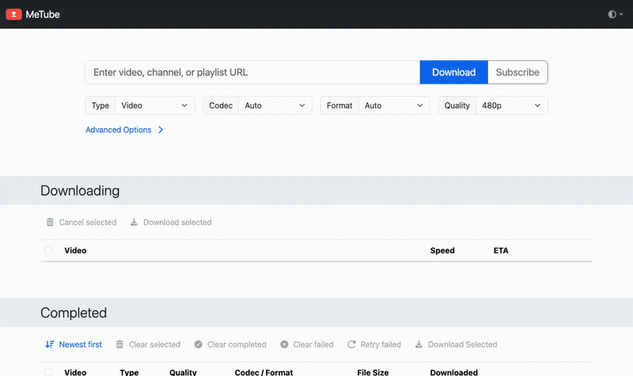

Screenshot: upstream MeTube README — the add-link form with a download in progress (alexta69/metube, `screenshot.gif`).

# Deploy and Host

MeTube is a self-hosted web UI for yt-dlp: paste a link from YouTube or hundreds of other sites and it downloads to your server — video, audio, playlists, channels, and subscriptions, with a queue you can watch fill up in real time. One click deploys the official image (alexta69/metube 2026.11.14, AGPL-3.0) as a single service with a persistent downloads volume. The deploy form is empty: no accounts, no setup wizard, no email step — open the URL and paste your first link.

## About Hosting

MeTube runs as one Python (aiohttp) service from the official image, pinned by digest. Downloads, queue state, history, subscriptions, and uploaded cookies live on a Railway volume (`/downloads`) and survive redeploys. The app boots in seconds and idles in well under 256 MB; downloads are the only real load, and they are the point. Railway's injected `PORT` is honored on every boot, and the healthcheck is `/` (the UI itself, unauthenticated, 200). The stock entrypoint chowns the volume to its runtime user on boot, so Railway's root-owned volume works with no wrapper fix — the other MeTube template on the marketplace sits at 0% health with 39 deploys for exactly the port/volume handling this wrapper gets right.

## Why Deploy

- **Zero-fuss start:** no setup wizard, no account, no email step — the UI is usable the second the deploy goes green.
- **Real downloads:** video and audio extraction, playlists and channels, subscriptions that re-check on a schedule, clip-by-chapters, and a download history you can re-queue from.
- **Always-on by design:** a single lightweight service with state on a volume — paste a link whenever, from any device.
- **Private by default:** downloads land on your own volume; no third-party downloader service sees your links.

## Common Use Cases

- Archive videos from YouTube and other sites to your own storage before they disappear.
- Pull audio-only versions of talks, lectures, and music for offline listening.
- Subscribe to a channel or playlist and have new uploads download automatically.
- Grab a clip of a long video by start/end time without downloading the whole thing.

## Dependencies for

### Deployment Dependencies

- **Runtime:** single Python service; idles in well under 256 MB.
- **Port:** Railway's injected `PORT` (8080 by default), honored by the app on every boot; the image default is 8081 when `PORT` is unset.
- **Persistence:** one Railway volume at `/downloads` (downloads, state, temp files).
- **Healthcheck:** `/` (unauthenticated, 200).
- **Plan tier:** Hobby plan; no companion services.

**Environment variables (condensed reference):** no variables are required to deploy — the form is empty. Optional tunables, all with image defaults: `PORT` (`8081`, overridden by Railway's injected `PORT`), `DOWNLOAD_DIR` (`/downloads`, the volume), `AUDIO_DOWNLOAD_DIR` (same as `DOWNLOAD_DIR`), `TEMP_DIR` (`/downloads`), `STATE_DIR` (`/downloads/.metube` — queue, history, subscriptions, cookies), `MAX_CONCURRENT_DOWNLOADS` (`3`), `DOWNLOAD_DIRS_INDEXABLE` (`false`), `CUSTOM_DIRS` (`true`), `DEFAULT_THEME` (`auto`), `YTDL_OPTIONS` (`{}` — yt-dlp options as JSON), `LOGLEVEL` (`INFO`). See the [upstream environment variable reference](https://github.com/alexta69/metube#environment-variables) for the full list.
